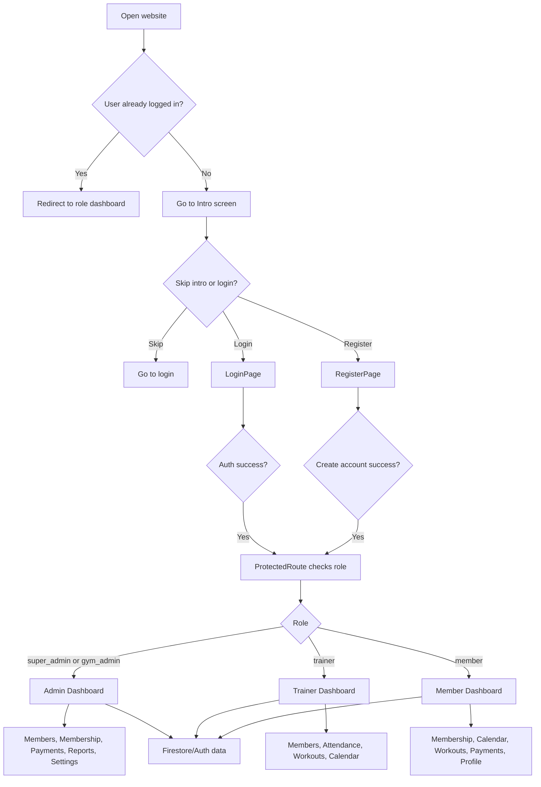

# Peter-GYM Application Guide

This guide explains the app as it is currently implemented in the codebase.

## 1) How many dashboards are there?

There are 3 main dashboards after authentication:

### 1. Admin dashboard

- Routes: /admin/dashboard
- Roles: super_admin and gym_admin
- Purpose: full gym operations dashboard
- This is the main control center for business management.

What it shows:

- Overview cards: total members, active members, revenue, pending payments
- Revenue chart and membership pie chart
- Attendance chart
- System activity widgets
- Access to members, plans, payments, reports, notifications, settings, trainer records

### 2. Trainer dashboard

- Route: /trainer/dashboard
- Role: trainer
- Purpose: trainer operations and assigned member monitoring

What it shows:

- Assigned members summary
- Today sessions
- Completion rate
- Simple view of member performance

### 3. Member dashboard

- Route: /member/dashboard
- Role: member
- Purpose: personal fitness dashboard

What it shows:

- Welcome card
- Current membership plan
- Attendance count
- Workout streak
- Payment status

---

## 2) What happens from open to dashboard?

The flow is:

1. Open website
2. App checks whether a saved user exists
3. If user is logged in, redirect to their role dashboard
4. If no user is logged in, redirect to /intro
5. Intro screen shows brand splash + profile image + countdown
6. User can click Skip Intro or Login
7. Login page accepts email/password
8. Register page lets user create account and choose a role
9. AuthProvider checks Firebase first, then local demo fallback
10. ProtectedRoute checks allowed roles
11. AppShell loads the correct sidebar for that role
12. User reaches the dashboard for that role

---

## 3) What features exist for each dashboard?

### Admin dashboard features

Visible in admin sidebar:

- Dashboard
- Members
- Membership
- Calendar
- Attendance
- Workouts
- Classes & Schedule
- Trainers
- Payments
- Reports
- Notifications
- My Profile
- Developer Profile
- Settings
- Logout

Admin can:

- view system overview
- search members
- add and manage member records
- view membership plans
- change plan status (active/archive)
- update billing view and payment records
- manage attendance and class schedule
- access reports
- send or view notifications
- manage gym settings

### Trainer dashboard features

Visible in trainer sidebar:

- Dashboard
- Members
- Membership
- Calendar
- Attendance
- Workouts
- Classes & Schedule
- Notifications
- My Profile
- Developer Profile
- Logout

Trainer can:

- view assigned members
- view trainer summary metrics
- see member progress cards
- view attendance and schedule
- access workout plans and member list

### Member dashboard features

Visible in member sidebar:

- Dashboard
- Membership
- Calendar
- Attendance
- Workouts
- Classes & Schedule
- Payments
- Notifications
- My Profile
- Developer Profile
- Logout

Member can:

- view personal dashboard
- check membership plan status
- view calendar and class schedule
- view attendance
- see workout plans
- pay membership due fees
- view notifications
- review personal profile

---

## 4) Which sidebar menu contains each feature?

The sidebar menu is defined in the file src/App.tsx under sidebarMenus.

### Admin menu

Contains the full operations set.

Examples:

- Dashboard -> /admin/dashboard
- Members -> /admin/members
- Membership -> /admin/memberships
- Calendar -> /admin/calendar
- Payments -> /admin/payments
- Reports -> /admin/reports
- Settings -> /admin/settings

Data appears inside the main content area in AppShell after the header and before the mobile bottom nav.

### Trainer menu

Contains smaller operational tools.

Examples:

- Dashboard -> /trainer/dashboard
- Members -> /trainer/members
- Attendance -> /trainer/attendance
- Workouts -> /trainer/workouts
- Calendar -> /trainer/calendar

### Member menu

Contains personal fitness and billing features.

Examples:

- Dashboard -> /member/dashboard
- Membership -> /member/membership
- Payments -> /member/payments
- Calendar -> /member/calendar
- Workouts -> /member/workouts
- My Profile -> /member/my-profile

---

## 5) What is already working vs missing?

### Already working

- splash intro screen with countdown and Skip Intro
- login page with demo credentials
- register page with role selection
- protected route handling
- role-based redirection after login
- dark/light theme switch
- responsive sidebar and mobile menu
- admin dashboard overview cards and charts
- members directory search and filter
- add new member form
- membership plan cards with billing cycle switch
- payment page with UPI / Google Pay / PhonePe style checkout UI
- calendar page mock schedule
- attendance page mock data screens
- reports page summary cards
- notifications page layout
- developer profile page
- my profile page
- settings page
- app shell layout and navigation

### Incomplete or still demo-only

- Firebase is not fully connected unless API keys are set in .env
- real Firestore data is not active in this environment yet
- login/register may fall back to demo localStorage mode
- forgot password and reset password pages are static UI only
- user profile editing is not connected to Firebase
- member data is primarily mock data from src/data/mockData.ts
- payment processing is simulated; it does not do real payment verification
- UPI flow is a mock deep link, not a full payment gateway
- attendance tracking is UI/demo based
- reports are static mock data
- notifications are mock data only
- there is no real admin CRUD backend yet
- no real trainer assignment logic between trainers and members
- no real analytics from Firestore

### Good next features to add

1. Real Firebase Firestore collections:
   - users
   - members
   - trainers
   - membershipPlans
   - payments
   - attendance
   - notifications
2. Member CRUD with add/edit/delete fully connected to Firestore
3. Payment verification with server-side or backend-safe flow
4. Real attendance marking with check-in and check-out
5. Calendar scheduling by class or trainer
6. Notifications system with read/unread state
7. Real profile editing and image upload
8. Role-based admin permissions stronger than the current demo logic
9. PDF/CSV export for reports and payments
10. Admin trainer assignment management

---

## 6) How will it work with Firebase Authentication and Firestore?

### Firebase Authentication

In src/lib/firebase.ts:

- Firebase is initialized only if environment variables exist
- auth is created with getAuth(app)
- login uses signInWithEmailAndPassword(auth, email, password)
- register uses createUserWithEmailAndPassword(auth, email, password)
- logout uses signOut(auth)
- onAuthStateChanged watches the user session globally

### Firestore

- Firestore is initialized with getFirestore(app)
- When a user registers, the app stores a document in users/{uid}
- On login, the app reads that document and builds the current session
- The app stores the session in localStorage as gymflow-user for demo fallback

### Current code behavior

- If Firebase keys are present, it uses real Firebase
- If not, it uses local demo data and localStorage fallback
- That means the app works without Firebase, but it is not a production-ready database-connected app yet

### Recommended Firestore structure

users/{uid}

- id
- name
- email
- role
- gymId
- avatar
- createdAt

members/{memberId}

- memberId
- name
- plan
- trainer
- status
- membershipStart
- membershipEnd

payments/{paymentId}

- memberId
- memberName
- amount
- method
- status
- date
- reference

attendance/{recordId}

- memberId
- date
- checkIn
- checkOut
- status

notifications/{notificationId}

- title
- message
- userId
- createdAt
- read

---

## Simple flowchart

---

## Final summary

This project is already a strong front-end gym management demo. It has the structure, role system, sidebar, screens, and premium UI expected from a gym app. The main missing part is the real backend connection.

Right now, it is best described as:

- a complete UI and role-based dashboard prototype
- a working demo app with local fallback data and Firebase-ready architecture
- not yet a full production gym system until Firebase and Firestore are fully connected and real CRUD flows are added

If you want the next step, the most practical plan is:

1. connect real Firebase Authentication
2. create Firestore collections
3. make Members, Payments, Attendance, and Profiles real
4. add real trainer assignments and notifications
5. final polishing for reports and exports
